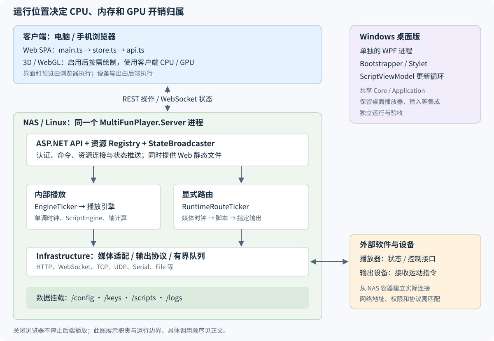

# 当前整体框架与代码导读

本文依据 **2026-10-26 当前工作树**整理，覆盖 `feature/web-linux-fnos-migration` 分支以及本轮性能调整。
其中部分修改尚未发布；目标 NAS 是否具备这些行为，取决于部署的镜像版本。
文中的文件路径均相对仓库根目录。

先抓住三个职责：**后端决定时间和设备输出，浏览器发送操作并显示状态，部署层提供进程和数据目录。**
Windows/WPF 是保留的另一个运行入口，共享部分核心代码，同时保留桌面专用逻辑。

建议按本文顺序读：先看运行边界和项目分层，再跟两条播放链路，最后看 Web、NAS 和验证入口。
具体安装命令见[使用与部署手册](./current-usage-testing-deployment.md)，性能数据见[性能复查报告](./performance-review.md)。

## 1. 代码分别运行在哪里



| 运行位置 | 承担的工作 | 主要资源消耗 |
| --- | --- | --- |
| 访问页面的电脑或手机 | Web 页面、交互状态、3D 预览、REST 请求、WebSocket 订阅 | 浏览器 CPU、JS heap、客户端 GPU |
| Linux/NAS 上的 Server 进程 | 播放时钟、脚本插值、路由、输出、媒体状态、配置、日志、静态页面服务 | NAS CPU、进程内存、磁盘和网络 |
| 外部播放器/媒体服务器 | 提供播放位置、播放状态和控制接口 | 由对应软件及设备承担 |
| 外部控制器/设备 | 接收 TCode 或设备协议指令 | 由对应设备承担 |
| Windows 桌面进程 | WPF 界面、桌面播放器集成、快捷键、桌面输出循环 | Windows 设备的 CPU、内存和图形资源 |

浏览器关闭后，Server 仍独立运行。3D 使用浏览器的 WebGL，NAS 负责提供脚本和静态文件；
在手机上打开 NAS 页面，渲染负担就在手机上。
设置页的 3D 当前是轴参数和模拟动作预览，绘制本身不会驱动真实输出；保存轴配置、播放命令等由独立 API 处理。

## 2. 先认清工程分层

| 工程/目录 | 职责 | 第一个建议打开的文件 |
| --- | --- | --- |
| `Source/MultiFunPlayer.Core` | 关键帧、插值、脚本读取、轴定义及通用契约 | `Common/KeyframeCollection.cs`、`Script/IScriptReader.cs` |
| `Source/MultiFunPlayer.Application` | 平台无关的播放状态、时钟、脚本求值、输出帧和接口 | `HeadlessPlayerEngine.cs`、`ScriptEngine.cs` |
| `Source/MultiFunPlayer.Infrastructure` | TCP/UDP/WebSocket/串口/文件传输、媒体和设备适配器、基础存储 | `Transport/BoundedOutputTransport.cs` |
| `Source/MultiFunPlayer.Server` | ASP.NET 宿主、API、认证、资源注册表、后台调度和持久化 | `Program.cs` |
| `Source/MultiFunPlayer.Web` | TypeScript + Vite SPA、自定义 store、DOM 更新、3D 预览 | `src/main.ts`、`src/store.ts`、`src/api.ts` |
| `Source/MultiFunPlayer` | 原 Windows/WPF 程序，Stylet/MVVM、桌面集成和插件等 | `Bootstrapper.cs` |
| `deploy`、根目录 `Dockerfile` | Docker 镜像、Compose、fnOS 应用包和生命周期脚本 | `Dockerfile`、`deploy/fnos/fnpack/app/docker/docker-compose.yaml` |
| `tools` | 验证矩阵、持续播放、升级验证、CPU/内存测量 | `run-validation-matrix.py`、`profile-runtime.py` |
| `Docs` | Docusaurus 文档站，拥有独立构建链 | `docs/intro.md` |

当前项目引用方向如下；箭头表示左侧引用右侧：

```text
Application    → Core
Infrastructure → Application、Core
Server         → Application、Infrastructure、Core
Windows/WPF    → Application、Core
Web            → 通过 HTTP / WebSocket 使用 Server
```

阅读时有四个容易混淆的地方：

- Web 应用使用 TypeScript 和直接 DOM 更新；`Docs` 使用的 React/Docusaurus 属于文档站。
- `/hubs/state` 是原生 WebSocket 端点，名称虽然包含 hubs，当前实现没有使用 SignalR。
- `ScriptCatalog` 在 Server 和 Infrastructure 都有同名类型。实际脚本 HTTP API、匹配和路由使用 **Server 的 `ScriptCatalog`**，支持多根目录。
- Core 中仍使用 `MultiFunPlayer.Common`、`MultiFunPlayer.Script` 等命名空间。桌面目录还保留一些旧同名文件，部分通过 `.csproj` 的 `Compile Remove` 排除；判断实现归属时要同时看项目文件。

## 3. 从 Server 启动入口读起

打开 `Source/MultiFunPlayer.Server/Program.cs`，先跳到文件末尾的 `ProgramEntryPoint.Main`：

```text
Main
  → 确定发布目录下的 wwwroot
  → WebApplication.CreateBuilder
  → ServerProgram.Configure：注册共享实例和后台服务
  → builder.Build
  → ServerProgram.Map：注册中间件、API、WebSocket、静态文件
  → app.Run：启动宿主生命周期
```

再回到 `Configure`，先找下面这些单例。这里的 Registry 可以理解为“负责某类资源的定义、连接状态和生命周期的管理器”。

| 实例 | 管理什么 |
| --- | --- |
| `HeadlessPlayerEngine` | 当前全局脚本、内部播放位置、播放状态和轴结果 |
| `MediaSourceRegistry` | 内部时间线、外部媒体连接、最近一次媒体时钟样本及控制命令 |
| `OutputTargetRegistry` | 输出目标定义、连接、限速、诊断和输出注册 |
| `RuntimeRoutingRegistry` | 哪个媒体源连接哪些输出，以及采用哪个脚本 |
| `DeviceAxisRegistry` | 轴范围、反向、限制、插值策略等设置 |
| `RuntimeScriptEvaluator` | 路由独立脚本的解析缓存和求值 |
| `StateBroadcaster` | 把引擎快照分发给浏览器订阅者 |

最后看两个后台服务：`EngineTicker` 驱动全局内部时间线，`RuntimeRouteTicker` 驱动显式路由。
`RuntimeRouteTicker` 与路由注册表放在同一个 `RuntimeRoutingRegistry.cs` 文件中。
它们都在 Server 进程里，生命周期由 ASP.NET 宿主管理。

**读到这里应能回答：谁持有全局播放状态，谁定时推进它，谁把结果发送给浏览器。**

## 4. 带读一：加载脚本，然后内部播放

这条链路适合先理解脚本如何变成设备数值。

### 4.1 从 UI 到后端命令

先读 Web 的 `src/api.ts`：`loadScript`、`command`、`seek`。
它们分别请求 `/api/v1/scripts/load`、`/api/v1/player/play|pause|stop` 和 `/api/v1/player/seek`。
然后在 Server 的 `Program.cs` 搜索相同路由。

加载请求可指定脚本 ID，也可携带脚本文本。目录读取由 Server 的 `ScriptCatalog` 承担，
解析交给 Core 的 `FunscriptReader`，解析成功后调用 `HeadlessPlayerEngine.Load`。
Server 的目录/API 当前围绕 `.funscript`、`.json` 工作；Core 中存在其他读取器不等于这些格式已接入该 Web API。

### 4.2 时间如何推进

接着看 `Application/HeadlessPlayerEngine.cs` 的 `Play`、`Tick`、`Pause`、`Seek`，以及 `Clock.cs`。
内部时间采用基于 `Stopwatch` 的单调时钟，通过播放锚点计算位置。
`EngineTicker` 播放时按配置周期调用 `Tick`，默认 20 Hz，也就是约 50 ms 一次，配置范围为 1–20 Hz。

```text
EngineTicker
  → HeadlessPlayerEngine.Tick
  → ScriptEngine.Evaluate(position, axisConfigurations)
  → 查询关键帧区间、插值、应用轴配置
  → OutputFrame / EngineSnapshot
```

再读 `Application/ScriptEngine.cs` 的 `Evaluate`：每个轴有对应轨道，先根据时间找关键帧，
再按插值策略求值，最后经 `AxisConfiguration.Apply` 应用轴配置。
这一层只算数值，不负责网络、串口、浏览器或 WPF 控件。

### 4.3 同一结果如何到达设备和页面

`HeadlessPlayerEngine.Publish` 把结果交给注册的 `IOutputSink`，并发出 `SnapshotChanged`。
`EngineTicker` 的事件处理将快照传给 `StateBroadcaster`，WebSocket 再发送给浏览器。

对于未显式路由的已连接输出，`OutputTargetRegistry` 将 sink 注册在全局引擎上。
目标进入显式路由后，会移除该全局注册，改由路由调度器调用 `PublishRouted`，避免同时受到两条链路驱动。

TCode 输出继续经过 `RateLimitedOutputSink`、`TCodeOutputSink` 和具体 transport；
The Handy、Buttplug 则有各自的协议适配器。
输出目标的 `sourceAxis` 和 `updateRateHz` 决定它采样哪个轴、以多高频率发送。

**读到这里应能沿一次播放操作追到具体输出，同时知道 UI 推送只是结果订阅。**

## 5. 带读二：外部播放器联动并路由到设备

这条链路回答：视频在 Jellyfin、VLC 或 OFS 中播放时，NAS 如何跟随它。

先读 `Server/MediaSourceRegistry.cs` 的连接和状态处理，再读：

- `Infrastructure/Media/NetworkMediaSourceAdapter.cs`：Emby、Jellyfin、Plex、VLC、MPC 的 HTTP 协议处理；已连接后默认 500 ms 轮询。
- `Infrastructure/Media/OfsWebSocketMediaAdapter.cs`：接收 OFS WebSocket 事件和发送控制命令。

Registry 保存最近的位置、播放状态、速度和接收时间。
打开 `RuntimeRoutingRegistry.cs` 中的 `RuntimeRouteTicker.TickAsync`，按下面的顺序往下看：

```text
媒体状态样本 + 收样时间
  → 获取路由和已连接的输出
  → 播放中按“经过时间 × 速度”推算当前位置
  → 选择全局脚本或路由独立脚本
  → 求得轴数值
  → OutputTargetRegistry.PublishRouted
  → 输出限速与具体协议适配器
```

因此，外部状态每 500 ms 更新一次，并不表示设备只每 500 ms 收到一帧；路由可以在样本之间按默认 20 Hz 推算并输出。
真实网络延迟、播放器报告精度以及 NAS 调度抖动仍会影响同步效果。

路由定义的关键字段在 `RuntimeSourceRouteDefinition`：

| 字段 | 含义 |
| --- | --- |
| `SourceId` | 用哪个媒体源的时间 |
| `OutputIds` | 将结果送给哪些输出目标 |
| `ScriptId` | 显式选定的脚本；有值时交给 `RuntimeScriptEvaluator` |
| `ScriptMatchMode` | 全局脚本或按媒体名称匹配等模式 |
| `LoopEnabled` | 是否启用路由提供的循环控制 |

当前最多支持 128 个源路由、512 条源到输出的连接，一个输出只能绑定一个源。

`RuntimeScriptMatcher` 负责名称归一化和匹配。
当前匹配是在路由加载/保存时由 `ResolveScriptBindings` 调用；不要据此推断已经存在全时文件扫描，
或每次外部媒体切换都会自动重新绑定脚本。

全局引擎状态与每个外部媒体源的状态也需要分开看：`/hubs/state` 推送全局引擎快照，
Runtime 页面还会读取 `/api/v1/media-sources` 来显示各个外部源的时钟。

**读到这里应能区分内部时钟、外部时钟样本、全局脚本和路由独立脚本。**

## 6. Web 与 3D 怎么读

按 `main.ts → store.ts → api.ts` 读一次操作，再反向沿响应回到页面：

| 文件 | 阅读重点 |
| --- | --- |
| `src/main.ts` | 路由和 DOM、点击/表单事件、`onStoreChanged`、`syncRuntimeWork`、页面可见性 |
| `src/store.ts` | `createMockStore` 与 `createRemoteStore`、状态变更通知、API 调用、socket 关闭和重连 |
| `src/api.ts` | DTO、REST 请求封装、Bearer 认证、`connectState` |
| `src/osr-axis-preview.ts` | 按需载入、姿态更新、申请一帧、可见性和资源释放 |
| `scripts/osr-demand-plugin.ts` | 适配固定版本 `osr-emu`，关闭库内部持续 RAF 并取消重复绘制 |

`?demo=1` 使用浏览器内模拟数据。普通入口会尝试连接 Server；读页面或测性能时先确认当前是 Demo 还是 Server 模式。
Web 的 `store.tick()` 只在需要时驱动 Demo 动画，真实设备的播放时钟由后端持有。

REST 用于操作和资源查询，WebSocket 用于引擎状态推送。服务端每个订阅者只保留一个待发快照，
新快照替换尚未发送的旧快照，避免慢浏览器积压无限队列。
状态 DOM 更新会合并到约 10 Hz；Runtime 的媒体状态轮询在可见页面运行，播放时约 500 ms、空闲约 2 s，且不重叠请求。
页面隐藏时停止 UI 动画、轮询及状态 socket，恢复后重新订阅；后端设备输出继续运行。

3D 的流程是：用户点击启用 → 动态导入模型库 → 姿态/相机/尺寸变化时申请一帧 → 稳定时不再请求 RAF。
页面隐藏或模型离开视口时停止绘制，离开设置页时释放场景几何、材质、阴影资源、controls 和 renderer。
模型包体积仍约 8 MB，本轮调整的是加载、绘制和释放时机。
库适配有 SHA-256 校验，升级 `osr-emu` 时需要一并复查适配逻辑。

## 7. NAS、Docker、fnOS 的部署链路

### 7.1 一个镜像同时提供 API 和 Web

从根目录 `Dockerfile` 按三个阶段读：

```text
Node 构建 Web dist
  → .NET 构建 Server，并将 dist 放入发布目录 wwwroot
  → ASP.NET runtime 镜像
  → dotnet MultiFunPlayer.Server.dll
```

容器运行时不需要 Node 开发服务器，也不会启动 WPF。
Server 提供同源静态文件、REST 和 WebSocket。
`Source/MultiFunPlayer.Web/Dockerfile` 是另一条前端预览镜像路径；NAS 完整应用使用根目录 Dockerfile。

普通 Docker 部署使用 `deploy/docker/compose.yaml`；fnOS 使用
`deploy/fnos/fnpack/app/docker/docker-compose.yaml`，引用已构建或已加载的镜像。
两份 Compose 当前都声明 2 CPU、512 MiB 的资源限制；实际生效值需核对目标容器运行配置。

`deploy/fnos/build-fpk.sh` 只打包 fnOS 应用描述、Compose、图标和生命周期脚本。
代码更新要先构建并部署相应镜像，单独生成新 FPK 不会重编译 Server/Web。

### 7.2 NAS 的路径映射

| 容器内路径 | 用途 | fnOS 宿主来源 |
| --- | --- | --- |
| `/app` | Server 发布产物和 `wwwroot` | 镜像内文件 |
| `/config` | 媒体、输出、路由、轴设置及认证等配置 | `${TRIM_PKGVAR}/config` |
| `/keys` | ASP.NET Data Protection 密钥 | `${TRIM_PKGVAR}/keys` |
| `/scripts` | 应用脚本目录 | `${TRIM_PKGVAR}/scripts` |
| `/logs` | 运行日志及 File 输出 | `${TRIM_PKGVAR}/logs` |
| `/scripts/external` | 授权的外部脚本目录，只读 | `${TRIM_PKGVAR}/authorized-scripts` 所指向目录 |

`StorageOptions` 接受 `MFP_*_ROOT` 和 `MFP_*_PATH`，同类值中 ROOT 优先。
脚本目录列表由 Server 的 `ScriptCatalog` 另外处理，支持 `MFP_SCRIPTS_PATHS`；
fnOS 默认把 `/scripts` 和 `/scripts/external` 都纳入读取范围。

fnOS 授权链路可以从 `Web/src/fnos.ts` 接着读到
`deploy/fnos/fnpack/cmd/sync_script_access` 和 `Server/FnosScriptAccess.cs`。
当前脚本会统计授权目录数量，但只选择第一个目录挂入 `/scripts/external`；
授权变化后通过状态文件报告是否需要重启应用，让容器重新挂载。

**这也解释了 NAS 路径一致的含义：算法和调度代码相同，运行环境、目录映射及可连接的设备不同。**
容器里的 `127.0.0.1` 指向容器自身，媒体服务器和设备 endpoint 必须从该容器可达。

## 8. 配置、接口与持久化入口

当前主要使用文件持久化，没有单独的数据库服务。
Registry 负责业务配置，`Infrastructure/Storage/RootedFileStore.cs` 提供根目录内的文件访问。

| API 入口 | 主要代码 | 对应配置或数据 |
| --- | --- | --- |
| `/api/v1/status`、`/api/v1/player/*` | `HeadlessPlayerEngine`、`ApiModelMapper` | 当前进程中的播放状态 |
| `/api/v1/media-sources` | `MediaSourceRegistry` | `media-sources.json` |
| `/api/v1/output-targets` | `OutputTargetRegistry` | `output-targets.json` |
| `/api/v1/runtime/routes` | `RuntimeRoutingRegistry` | `runtime-routes.json` |
| `/api/v1/device-axes` | `DeviceAxisRegistry` | `device-axis-settings.json` |
| `/api/v1/scripts`、`/api/v1/script-folders` | Server `ScriptCatalog` | 脚本根目录内的文件和文件夹 |
| `/api/v1/logs`、`/api/v1/logs/file` | `RuntimeLogStore` | 有界内存队列及轮替日志文件 |
| `/api/v1/auth/pair` | `AuthTokenStore` | 配对和访问令牌校验状态 |
| `/api/v1/adapters` | `AdapterCapabilityCatalog` | 已接入、阻塞或不支持的能力清单 |
| `/health/live`、`/health/ready` | `Program.cs` | 进程健康检查 |

完整字段和路径查 `/openapi/v1.json` 及 `Server/ApiModels.cs`。
服务端认证在 `Program.cs` 的中间件入口，浏览器 REST 使用 Bearer，状态 WebSocket 使用子协议传递令牌。
旧桌面配置迁移由 `ConfigurationMigrationHostedService` 处理；看到迁移结果文件不代表所有桌面功能都已经接入便携后端。

## 9. 性能设计与目前边界

| 场景 | 当前执行策略 |
| --- | --- |
| 全局引擎停止或暂停 | 等待状态事件，空闲 Tick 不创建新快照，不周期发送相同输出 |
| 无可播放路由或无连接输出 | 路由调度等待唤醒；有有效播放任务时恢复周期计算 |
| 外部 HTTP 媒体源已连接 | 保留检测外部播放变化所需的轮询 |
| Web 页面隐藏 | 暂停前端更新与订阅，后端照常运行 |
| 3D 静止或不可见 | 不持续绘制；用户操作及模拟才触发所需更新 |
| 脚本解析缓存 | 移除不再被路由引用的脚本，成功/失败缓存各限 128 项，失败重读退避 |
| 慢输出或慢浏览器 | 有界队列/限速，避免无界积压 |

这些调整不能解释为“整个进程空闲时绝对零 CPU”。宿主、HTTP 连接、健康检查、GC 和必要的设备通信仍可能工作。
脚本缓存条数限制也不是字节预算，大脚本及大量并发路由仍需进一步测量。

当前代码已接入 Internal、OFS、Emby、Jellyfin、Plex、VLC、MPC 媒体路径，
以及 TCP、UDP、WebSocket、File、Serial、The Handy、Buttplug 输出。
这些是代码接入状态，真实 endpoint、权限和设备验收仍决定可用性；以 `/api/v1/adapters` 和目标环境证据为准。
MPV、DeoVR、HereSphere、Whirligig 等桌面集成尚未因此自动成为 NAS 能力。
`feature-matrix.md` 是早期迁移规划基线，阅读当前状态时应同时核对实现清单。

## 10. Windows 桌面版从哪里接着读

按下面的顺序进入保留的桌面路径：

1. `Source/MultiFunPlayer/Bootstrapper.cs`：Stylet 依赖注入、配置、日志和桌面启动。
2. `UI/Controls/ViewModels/ScriptViewModel.cs`：轴状态、脚本更新线程和 UI 更新。
3. `MediaSource/` 与 `OutputTarget/`：桌面播放器集成及输出生命周期。
4. `Application/StyletApplicationAdapters.cs`、`Input/`、`MotionProvider/`、`Plugin/`：桌面消息适配、输入、动作生成和插件扩展。

桌面项目引用 Core/Application，并通过适配器衔接原有消息与 UI；它仍有独立的 `ScriptViewModel` 更新循环。
本轮分别调整了 Server 空闲调度和桌面空闲等待，因此不能用 NAS 的 CPU 数据推算 Windows 桌面降幅。

## 11. 修改代码时如何定位与验证

| 想改的行为 | 优先阅读/修改 | 主要验证入口 |
| --- | --- | --- |
| 插值、轴值、内部播放时钟 | Core、Application | `MultiFunPlayer.Core.Tests`、`MultiFunPlayer.Application.Tests` |
| 协议解析、网络和串口输出 | Infrastructure 对应适配器 | `MultiFunPlayer.Infrastructure.Tests`，再做真实设备验证 |
| API、路由、持久化、后台调度 | Server 对应 Registry/服务 | `MultiFunPlayer.Server.Tests`、`IdleSchedulingTests.cs` |
| 页面操作、状态同步 | Web `main.ts`、`store.ts`、`api.ts` | typecheck、静态检查、`tests/control-room.spec.ts` |
| 3D 和前端空闲占用 | `osr-axis-preview.ts`、Vite 适配插件 | `tests/performance.spec.ts`、`tools/profile-browser.mjs` |
| NAS 打包、挂载和升级 | 根 Dockerfile、`deploy/docker`、`deploy/fnos` | 打包/静态检查及目标 NAS 安装升级验证 |
| Windows 桌面行为 | `Source/MultiFunPlayer` | 桌面构建、`MultiFunPlayer.Tests` 和 Windows 实机 |

已有的本轮验证结果是：121 项便携 .NET 测试、18 项浏览器测试、全方案编译和短时持续播放检查通过。
这组结果不等于 Windows 运行、真实 GPU/NAS/ARM、物理设备或 8 小时稳定性已经验收。

推荐用以下入口继续实践；命令从仓库根目录执行：

```sh
./build.sh doctor
./build.sh run server
# 另开终端运行 Web Demo，可用于观察 UI 和 3D
./build.sh run web
```

测量工具分别是 `tools/profile-runtime.py`、`tools/profile-browser.mjs` 和 `tools/run-portable-soak.py`。
构建前置条件、实测方法和结果见[性能复查报告](./performance-review.md)；
部署和认证参数见[使用与部署手册](./current-usage-testing-deployment.md)。

完成一轮阅读后，可以用四个问题自查：播放位置由谁推进、外部媒体如何映射到脚本、输出走全局还是路由、当前消耗的是 NAS 还是浏览器资源。
能从问题定位到相应文件，再向下跟一层调用，就已经掌握了当前框架的主线。
